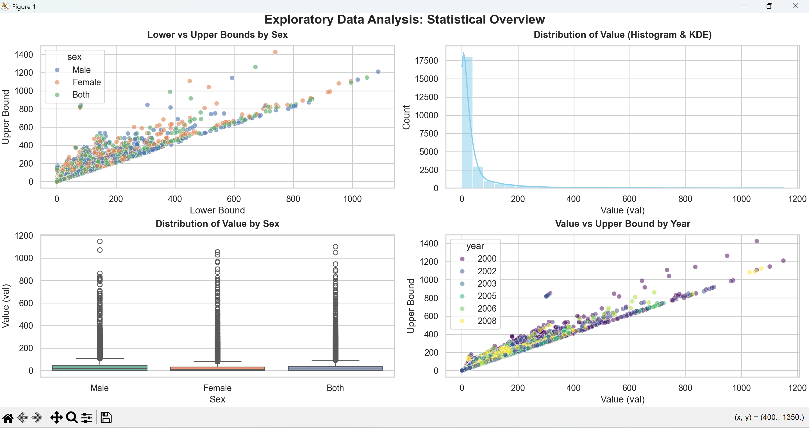

# Exploratory Data Analysis & Visualization (Pandas & Seaborn)

A student pet project demonstrating exploratory data analysis (EDA) and statistical visualization using **Python**, **Pandas**, **Seaborn**, and **Plotly**.

---

### 📊 About the Project
This project explores dataset metrics to uncover patterns, correlations, and distributions. It covers statistical summaries, multi-plot dashboards, regression analysis, and interactive visualizations.

### 🛠 Tech Stack
- **Language:** Python 3.x
- **Libraries:** 
  - `pandas` & `numpy` (Data manipulation & analysis)
  - `matplotlib` & `seaborn` (Static statistical charts & dashboards)
  - `plotly` (Interactive data visualization)

---

### 📈 Visualizations & Results

#### 1. Exploratory Data Analysis Dashboard (2x2 Grid)
The multi-plot dashboard combines scatter plots, distribution histograms with KDE, and boxplots to provide a comprehensive statistical overview:


#### 2. Joint Distribution with Regression Line
Analyzing the relationship between values and upper bounds using regression fitting:


---

### 🚀 How to Run Locally

1. **Clone the repository:**
   ```bash
   git clone [https://github.com/boikko/eda-dataset-analysis.git](https://github.com/boikko/eda-dataset-analysis.git)
   cd eda-dataset-analysis
2. Install required dependencies: 
pip install pandas numpy matplotlib seaborn plotly

3. Run the script:
python lab5_1.py
