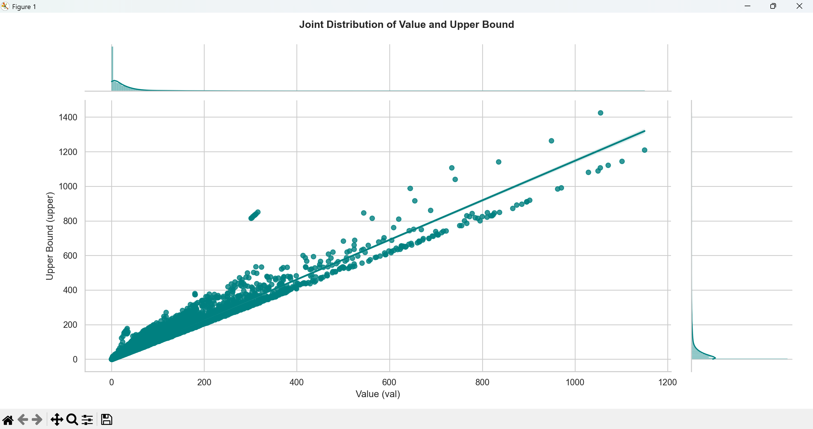
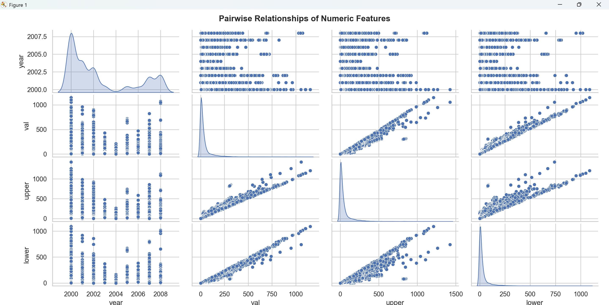
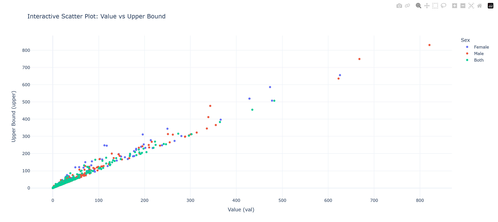

# Exploratory Data Analysis & Visualization (Pandas & Seaborn)

A student pet project demonstrating exploratory data analysis (EDA) and statistical visualization using **Python**, **Pandas**, **Seaborn**, and **Plotly**.

---

### 📊 About the Project
This project explores dataset metrics to uncover patterns, correlations, and distributions. It covers statistical summaries, multi-plot dashboards, regression analysis, correlation matrices, and interactive data visualizations.

### 📁 About the Dataset
The dataset contains **24,231 records** covering global public health statistics (specifically mortality rates across different regions and years):
- **`location`**: Countries and regions worldwide (over 200 locations).
- **`sex`**: Demographic breakdown (`Male`, `Female`, `Both`).
- **`cause`**: Causes of death or disease groups (e.g., chronic respiratory diseases, injuries, etc.).
- **`year`**: Observation years ranging from **2000 to 2008**.
- **`val`**: Central estimated mortality rate value.
- **`upper` & `lower`**: Upper and lower bounds of the statistical confidence intervals.

> **📌 Note on Data:** The inclusion of lower and upper bounds required special attention during data cleaning and outlier handling due to variations in data collection quality across different global regions.

### 🛠 Tech Stack
- **Language:** Python 3.x
- **Libraries:** 
  - `pandas` & `numpy` (Data manipulation & analysis)
  - `matplotlib` & `seaborn` (Static statistical charts & dashboards)
  - `plotly` (Interactive data visualization)

---

### 📈 Visualizations & Results

> **💡 Key Insight:** The pairplot and regression analysis revealed a strong near-linear relationship between central estimates (`val`) and upper bounds (`upper`), highlighting a consistent statistical pattern across mortality categories.

#### 1. Exploratory Data Analysis Dashboard (2x2 Grid)
The multi-plot dashboard combines scatter plots, distribution histograms with KDE, and boxplots to provide a comprehensive statistical overview:


#### 2. Joint Distribution with Regression Line
Analyzing the relationship between values and upper bounds using regression fitting:


#### 3. Pairwise Relationships Matrix (Pairplot)
A correlation matrix across all numeric columns (`year`, `val`, `upper`, `lower`), showing pairwise scatter plots and univariate distributions:


#### 4. Interactive Plotly Scatter Plot
An interactive web-based scatter plot allowing you to hover over data points, inspect details (such as cause, year, and location), and explore the data dynamically:


---

### 🚀 How to Run Locally

1. **Clone the repository:**
   ```bash
   git clone [https://github.com/boikko/eda-dataset-analysis.git](https://github.com/boikko/eda-dataset-analysis.git)
   cd eda-dataset-analysis
   ```
2. Install required dependencies:
   ```bash
    pip install pandas numpy matplotlib seaborn plotly  
   ```
4. Run the script:
   ```bash
    python lab5_1.py
   ```
Created as part of practical software development & data analysis training.
